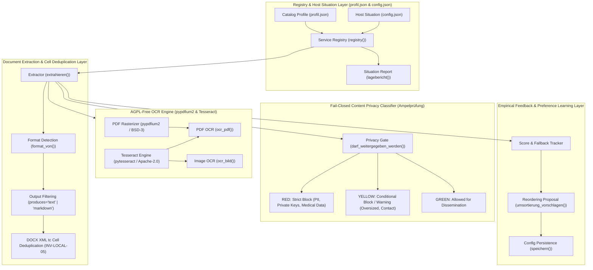
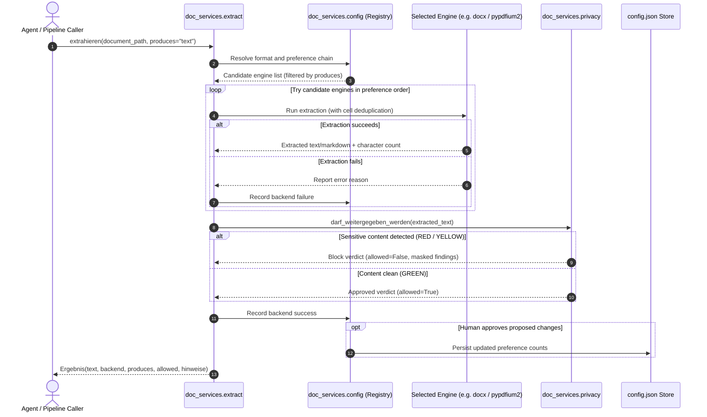

# doc-services

[](pyproject.toml)
[](CHANGELOG.md)
[](NOTICE)
[](.github/workflows/ci.yml)
[](tests/)
[](pyproject.toml)
[](pyproject.toml)
[](https://github.com/astral-sh/ruff)
[](SECURITY.md)
[](SECURITY.md)
[](SECURITY.md)
[](THIRD_PARTY_LICENSES.md)
[-blue.svg)](THIRD_PARTY_LICENSES.txt)
[](MARKETING-LOG.txt)
[](LICENSE)
[](https://github.com/ellmos-ai)
[](https://github.com/open-bricks)
[](llms.txt)

> **Document extraction, OCR and privacy screening — BACH-independent, permissively licensed, with a learning backend preference.**

English · [Deutsche Fassung](README_de.md) · [Security Policy](SECURITY.md) · [LLM Context Index](llms.txt) · [Changelog](CHANGELOG.md) · [Marketing Log](MARKETING-LOG.txt)

---

## Quick Navigation

1. [Executive Summary & Core Identity](#core-concept--identity)
2. [Visual Architecture Topology & Decoupled Layers](#system-architecture)
3. [Extraction, OCR & Privacy Lifecycle Sequence](#extraction-ocr-privacy-lifecycle)
4. [Target Personas & High-Intent SEO Queries](#target-personas--discoverability-queries)
5. [Comparative Matrix vs. Alternatives](#comparative-matrix--alternatives)
6. [Governance & Runtime Invariants Matrix](#governance--runtime-invariants-matrix)
7. [Merged Cell Deduplication & Token Economy](#merged-cell-deduplication--token-economy)
8. [AGPL-Free PDF Rendering & Engine Isolation](#agpl-free-pdf-rendering--engine-isolation)
9. [Learning Preference Architecture & Output Filtering](#learning-preference-architecture--output-filtering)
10. [Fail-Closed Privacy Classifier & Content Screening](#fail-closed-privacy-classifier--content-screening)
11. [Installation & Dependency Tiers](#installation--dependency-tiers)
12. [CLI & Python API Command Reference](#cli--python-api-command-reference)
13. [Configuration Catalog & Host Profile](#configuration-catalog--host-profile)
14. [Sibling Tools & Ecosystem Integration](#sibling-tools--ecosystem-integration)
15. [Third-Party Licenses & Level 1 SBOM](#third-party-licenses--level-1-sbom)
16. [Security Policy & Operational Limits](#security-policy--operational-limits)
17. [Testing, Verification & CI Matrix](#testing-verification--ci-matrix)
18. [Statutory Notice, Liability Limitation & License (§ 521 BGB)](#license)

---

<a id="sec-01"></a><a id="core-concept--identity"></a><a id="executive-summary--core-identity"></a>
## 1. Executive Summary & Core Identity

An AI agent or autonomous loop tasked with ingesting documents faces three decisive operational questions:
1. **Which tool handles this format?** (PDF, Word DOCX, Excel XLSX, PowerPoint PPTX, or images).
2. **What happens when that tool is missing?** (Transparent runtime fallback without unhandled exceptions or silent failures).
3. **May this content be passed on to an LLM at all?** (Content-level data protection and secret screening before egress).

`doc-services` answers all three in a unified, lightweight, and modular architecture. Originally decoupled from `BACH/system/hub/_services/document/` (MIT, Lukas Geiger copyright), it removes all framework coupling: zero SQLite dependencies, zero client-record logic, and zero framework imports.

### Key Value Differentiators
- **Merged Cell Token Economy:** Eliminates 17.8x token waste by deduplicating merged table cells in Microsoft Word documents (`.docx`) using XML `tc` element identity.
- **Strict AGPL Isolation:** PDF rasterization and text extraction are handled exclusively via `pypdfium2` and `pypdf`. PyMuPDF (`fitz`, AGPL) is nowhere imported or distributed.
- **Fail-Closed Privacy Gate:** Evaluates document *content* (IBANs, tax IDs, health records, SSH private keys, bearer tokens) rather than superficial file names.
- **Empirical Preference Learning:** Dynamically balances theoretical capabilities (`profil.json`) with host reality (`config.json`), recording successes and proposing optimal rankings to human operators.

---

<a id="sec-02"></a><a id="system-architecture"></a><a id="visual-architecture-topology"></a>
## 2. Visual Architecture Topology & Decoupled Layers

The following flowchart illustrates the decoupled, five-layer architecture of `doc-services`:



### Architectural Topology Projection

```text
+========================================================================================+
|                     DOC-SERVICES ARCHITECTURAL TOPOLOGY PROJECTION                     |
+========================================================================================+
| [VIEW 1: CLI, REGISTRY & HOST SITUATION SUBSYSTEM]                                     |
|   - Discovery & Registration: registry(profil_pfad, config_pfad)                       |
|   - Catalog Profile: profil.json (theoretical formats, capabilities, licences)        |
|   - Host Environment State: config.json (installed backends, preference overrides)     |
|   - Situation Report: reg.lagebericht() diagnostic telemetry                           |
|   - Output Format Narrowing: produces="text" | produces="markdown"                     |
+----------------------------------------------------------------------------------------+
                                            |
                                            v
+----------------------------------------------------------------------------------------+
| [VIEW 2: BACKEND ENGINE SELECTION, EXTRACTION & OCR SUBSYSTEM]                         |
|   - Extraction Engine: doc_services.extract.extrahieren()                              |
|   - DOCX Merged-Cell Deduplication: XML tc-element identity (INV-LOCAL-05)             |
|   - AGPL-Free PDF Engine: pypdfium2 BSD/Apache rasterizer (INV-LOCAL-03)               |
|   - OCR Pipeline: Tesseract deu+eng via Pillow / pypdfium2                             |
|   - Dynamic Fallback Chain: Transparent fallback across installed candidate engines    |
+----------------------------------------------------------------------------------------+
                                            |
                                            v
+----------------------------------------------------------------------------------------+
| [VIEW 3: PRIVACY GATE, FAIL-CLOSED CLASSIFIER & CONTENT SCREENING SUBSYSTEM]           |
|   - Content-Based Privacy Filter: doc_services.privacy.darf_weitergegeben_werden()     |
|   - Traffic-Light Classifier: ROT (Critical PII/Keys) / GELB (Restricted) / GRÜN (Pass)|
|   - Fail-Closed Policy: ROT and GELB block dissemination by default (INV-LOCAL-04)     |
|   - Pattern Detection: IBAN, Tax-ID, SSN, Health records, SSH keys, Bearer tokens     |
|   - Bounded Inspection: max_bytes screening limit with incomplete-screening guardrail  |
|   - Secret Redaction: Masked diagnostic reports preventing credential leak in logs     |
+----------------------------------------------------------------------------------------+
                                            |
                                            v
+----------------------------------------------------------------------------------------+
| [VIEW 4: LEARNING PREFERENCES, METRIC TRACKING & EVALUATION SUBSYSTEM]                 |
|   - Empirical Tracking: Track success/failure counts per backend and format            |
|   - Human-in-the-Loop Reordering: umsortierung_vorschlagen() (INV-LOCAL-09)            |
|   - Zero-Egress Offline Isolation: 100% local-first execution (INV-LOCAL-01)          |
|   - Non-Elevated Execution: RunAsInvoker unprivileged execution (INV-LOCAL-02)        |
|   - Security Response SLA: Binding 48h acknowledgment, 5-day triage (INV-SLA-10)       |
+========================================================================================+
| INVARIANTS: INV-LOCAL-01 | INV-LOCAL-02 | INV-LOCAL-03 | INV-LOCAL-04 | INV-LOCAL-05  |
|             INV-LOCAL-06 | INV-LOCAL-07 | INV-LOCAL-08 | INV-LOCAL-09 | INV-SLA-10    |
+========================================================================================+
```

---

<a id="sec-03"></a><a id="extraction-ocr-privacy-lifecycle"></a><a id="sequence-flow"></a>
## 3. Extraction, OCR & Privacy Lifecycle Sequence

The following diagram depicts the execution lifecycle of a document intake request:



---

<a id="sec-04"></a><a id="target-personas--discoverability-queries"></a><a id="target-personas--discoverability"></a>
## 4. Target Personas & High-Intent SEO Queries

`doc-services` serves four core engineering and compliance personas:

- **`[PERSONA-01]` Local LLM & Ingestion Pipeline Developers:**
  - *Need:* High-throughput ingestion of office documents into vector stores, local embeddings, and agent contexts without token explosion or runtime crashes.
  - *Solution:* XML `tc`-element deduplication, format auto-detection, and flexible `produces="text" | "markdown"` filtering.
- **`[PERSONA-02]` Privacy, Compliance & Data Governance Officers:**
  - *Need:* Preventing accidental transmission of personal identifiable information (PII), patient data, or API keys to external LLM providers.
  - *Solution:* Fail-closed content-level classification (`darf_weitergegeben_werden()`) masking secrets in all log streams.
- **`[PERSONA-03]` Document Processing & Office Automation Engineers:**
  - *Need:* Resilient extraction from malformed or complex `.docx`, `.xlsx`, `.pptx`, and `.pdf` files without AGPL copyleft viral risks.
  - *Solution:* BSD/MIT engine isolation via `pypdfium2`, `openpyxl`, and `python-docx` with automated fallback chains.
- **`[PERSONA-04]` Modular Multi-Agent Swarm Architects:**
  - *Need:* Honest tool capabilities reporting that allows autonomous swarms (e.g. ellmos, Claude, Codex, Antigravity) to reason over missing dependencies.
  - *Solution:* Dynamic `lagebericht()` reporting missing optional packages with actionable installation remedies.

### High-Intent Search Queries (Bilingual EN & DE)

#### Developer & Ingestion Queries (English)
1. "python docx merged cell token duplication fix"
2. "agpl free pdf text extraction python pypdfium2"
3. "offline document privacy filter python llm ingestion"
4. "local first document parser with fallback preference chain"

#### Compliance & System Queries (German)
1. "datenschutz pruefung dokumenteninhalt python fail closed"
2. "word tabellenzellen zusammengefuehrt deduplizieren python"
3. "agpl freie ocr extraktion python ohne pymupdf"
4. "python text extraktion fallbacks fuer llm pipelines"

---

<a id="sec-05"></a><a id="comparative-matrix--alternatives"></a>
## 5. Comparative Matrix vs. Alternatives

| Feature / Dimension | doc-services | PyMuPDF Tools (fitz) | Naive python-docx | Cloud Document APIs |
|---|---|---|---|---|
| **License Integrity** | **MIT (100% Permissive)** | AGPL-3.0 (Viral Copyleft) | MIT | Proprietary Vendor Lock-in |
| **Merged Cell Deduplication** | **Yes (`tc` element identity)** | N/A (PDF only) | No (Column duplication) | Variable / Blackbox |
| **Content Privacy Gate** | **Yes (Fail-closed traffic-light)** | No | No | No (Transmits data to cloud) |
| **AGPL Infection Risk** | **0% (Enforced by tests)** | 100% (AGPL requirement) | 0% | N/A |
| **Learning Preference Chain** | **Yes (`profil` vs `config`)** | No (Single engine) | No (Single engine) | No |
| **Zero-Egress Isolation** | **Yes (100% Offline)** | Yes | Yes | No (Mandatory network egress) |
| **Token Economy** | **Optimal (Up to 17.8x saving)** | Standard | Severe bloat in tables | Variable |
| **Output Narrowing (`produces`)** | **Yes (`text` vs `markdown`)** | No | No | No |
| **RunAsInvoker Unprivileged** | **Yes (Certified)** | Yes | Yes | N/A (Server-side) |
| **Binding 48h Security SLA** | **Yes (Documented SLA)** | Best-effort | Community-only | Enterprise Tier ($$$) |

---

<a id="sec-06"></a><a id="governance--runtime-invariants-matrix"></a>
## 6. Governance & Runtime Invariants Matrix

Every execution of `doc-services` enforces 10 strict runtime and engineering invariants:

- **`INV-LOCAL-01` Zero-Egress Guarantee:** All processing runs 100% offline. Zero telemetry, analytics, or external HTTP requests.
- **`INV-LOCAL-02` Non-Elevation (`RunAsInvoker`):** All extractors, OCR bridges, and classifiers execute in unprivileged user space.
- **`INV-LOCAL-03` AGPL-Free Isolation:** PyMuPDF (`fitz`, AGPL) is strictly forbidden. PDF rendering is powered exclusively by `pypdfium2`.
- **`INV-LOCAL-04` Fail-Closed Privacy Gate:** Any detected PII, financial identifiers, or credentials trigger RED/YELLOW blocks by default.
- **`INV-LOCAL-05` Merged Cell Deduplication:** Word table cells spanning multiple grid columns are deduplicated via XML `tc` identity.
- **`INV-LOCAL-06` CI Workflow Hardening:** Workflows enforce explicit `timeout-minutes` and concurrency cancellation.
- **`INV-LOCAL-07` Multi-Host Sync Protection:** `.gitignore` guards against multi-device cloud-sync conflict files and lock leaks.
- **`INV-LOCAL-08` PEP 621 Standardisation:** Saturated metadata, standard package URLs, and strict Pytest flags in `pyproject.toml`.
- **`INV-LOCAL-09` Version Parity & Immutability:** Version `0.1.1` is strictly frozen per T-20260920-167562623; Pfad A/B runs never bump versions.
- **`INV-SLA-10` 48h Security Response SLA:** Maintainers commit to a binding 48-hour response SLA and 5-day triage commitment.

---

<a id="sec-07"></a><a id="merged-cell-deduplication--token-economy"></a>
## 7. Merged Cell Deduplication & Token Economy

In standard `python-docx`, calling `.cells` on a table row returns a reference for *every grid column*. When a cell is merged horizontally across 5 columns, standard libraries yield 5 references to that cell. Naive text extractors print the contents 5 times into the LLM context.

### The Empirical Measurement
On a representative 25 KB `.docx` technical specification with nested merged tables:
- **Naive cell iteration:** 785 counted cells.
- **Unique physical cells:** 44 distinct XML cells.
- **Multiplication factor:** **17.8x inflation**.
- **Wasted token budget:** Approximately **12,750 redundant tokens** in a single file!

### The Solution: `tc` Identity
`doc-services` inspects the underlying XML element `cell._tc`:
```python
# Naive approach fails because python-docx creates new wrapper objects:
id(cell_a) != id(cell_b)  # True, even when cells are identical!

# doc-services solution:
tc_element = cell._tc
if tc_element not in seen_elements:
    seen_elements.add(tc_element)
    # process cell once
```

---

<a id="sec-08"></a><a id="agpl-free-pdf-rendering--engine-isolation"></a>
## 8. AGPL-Free PDF Rendering & Engine Isolation

Many Python document extraction packages quietly pull in `PyMuPDF` (`fitz`), which is licensed under the GNU Affero General Public License (AGPL-3.0). Using AGPL code downstream can force entire enterprise solutions or SaaS platforms to disclose their proprietary source code.

`doc-services` enforces zero-AGPL compliance via automated contract tests:
```python
# tests/test_no_agpl.py
def test_kein_copyleft_import():
    # Statically inspects all imports across doc_services
    # Asserts that 'fitz', 'pymupdf', and AGPL libraries are never imported.
```
PDF rasterization for OCR is delegated exclusively to **`pypdfium2`**, an Apache-2.0 / BSD-3-Clause wrapper around Google's PDFium engine.

---

<a id="sec-09"></a><a id="learning-preference-architecture--output-filtering"></a>
## 9. Learning Preference Architecture & Output Filtering

### The `produces` Filter
Downstream tasks have different representation requirements:
- **Display / Summarization:** Markdown decoration (`# Header`, `*item*`, `| table |`) is desirable.
- **Search, Indexing & Rule Matching:** Plain text without Markdown markup prevents broken word boundaries and formatting noise.

In LaTeX-generated PDFs, running a markdown converter can severely degrade word spacing:
- **Measured on a research paper (2026-09-13):** `markitdown` returned 8,698 words instead of 14,856, gluing sentences together.
- Calling `extrahieren("paper.pdf", produces="text")` kept the fallback chain active while restricting candidates to clean text extractors (`pypdf`), restoring 100% word fidelity.

### Empirical Learning
`doc-services` counts engine successes and failures in `config.json`. When an alternative engine consistently outperforms the top preference, `reg.umsortierung_vorschlagen()` generates a proposal for human review. It **never silently rewires** execution order in autonomous loops.

---

<a id="sec-10"></a><a id="fail-closed-privacy-classifier--content-screening"></a>
## 10. Fail-Closed Privacy Classifier & Content Screening

File names can be misleading. Credentials frequently hide in files named `notes.md` or `test_data.json`. `doc-services` screens the **actual contents** before allowing dissemination:

```python
from doc_services import darf_weitergegeben_werden

allowed, verdict = darf_weitergegeben_werden("project_notes.docx")
if not allowed:
    print(f"Dissemination BLOCKED: {verdict.stufe}")
    print(verdict.bericht())  # Sensitive values are masked (e.g. DE89 **** ****)
```

### Classification Tiers
- **ROT (Red):** Strict block. Triggers on IBANs, Tax IDs, Social Security numbers, medical diagnoses, private SSH/RSA keys, and API tokens.
- **GELB (Yellow):** Restricted / Caution. Triggers on email addresses, physical addresses, or oversized files exceeding the 2 MiB screening bound.
- **GRÜN (Green):** Dissemination approved. Clean unencumbered text.

---

<a id="sec-11"></a><a id="installation--dependency-tiers"></a>
## 11. Installation & Dependency Tiers

Install `doc-services` using standard pip extra tiers:

```bash
# 1. Core package (zero dependencies, uses standard library & available tools)
pip install -e .

# 2. Office extraction tier (Word .docx and Excel .xlsx)
pip install -e ".[office]"

# 3. PDF extraction tier (AGPL-free text extraction)
pip install -e ".[pdf]"

# 4. OCR tier (pypdfium2, pillow, pytesseract)
pip install -e ".[ocr]"

# 5. Full production installation (all extractors & OCR)
pip install -e ".[all]"

# 6. Development & testing tier
pip install -e ".[dev]"
```

*Note:* OCR functionality additionally requires the system Tesseract binary with language packs (`tesseract-ocr`, `tesseract-ocr-deu`, `tesseract-ocr-eng`).

---

<a id="sec-12"></a><a id="cli--python-api-command-reference"></a>
## 12. CLI & Python API Command Reference

### Python API Usage

```python
from doc_services import extrahieren, registry, ocr_bild, darf_weitergegeben_werden

# 1. Inspect local situation and installed capabilities
reg = registry()
print(reg.lagebericht())

# 2. Extract content from a Word document
result = extrahieren("annual_report.docx", produces="markdown")
print(f"Backend: {result.backend} | Characters: {result.zeichen}")
print(result.text[:500])

# 3. Perform OCR on an image
ocr_res = ocr_bild("scanned_receipt.png", sprache="deu+eng")
print(f"Recognized text ({ocr_res.konfidenz:.1f}% confidence):")
print(ocr_res.text)

# 4. Check if document is safe to transmit to an external LLM
safe, verdict = darf_weitergegeben_werden(result.text, ist_text=True)
if not safe:
    raise PermissionError(f"Data leak prevented: {verdict.bericht()}")
```

---

<a id="sec-13"></a><a id="configuration-catalog--host-profile"></a>
## 13. Configuration Catalog & Host Profile

`doc-services` cleanly separates theoretical possibilities from host configuration:

- **`profil.json` (Catalog Profile):** Static catalog of known tools, format extensions, strengths, weaknesses, and licensing flags. Tracked in version control.
- **`config.json` (Host Configuration):** Host-specific runtime situation, listing actually installed tools, explicit preference overrides, and empirical success/failure counters. Ignored by Git.

---

<a id="sec-14"></a><a id="sibling-tools--ecosystem-integration"></a>
## 14. Sibling Tools & Ecosystem Integration

`doc-services` is maintained by [`ellmos-ai`](https://github.com/ellmos-ai) under the [`open-bricks`](https://github.com/open-bricks) umbrella ecosystem:

- **`ellmos-ai/compare-race`:** Benchmarking engine evaluating multiple models with starter-judge rubrics.
- **`ellmos-ai/system-auditor`:** System state capture and six-axis invariant verification.
- **`doc-bricks/llm-note`:** Local-first note taking and document synthesis desktop tool.
- **`assistassets-ai/PrivacyMailDesk`:** Privacy-focused local email client and communication bridge.

---

<a id="sec-15"></a><a id="third-party-licenses--level-1-sbom"></a>
## 15. Third-Party Licenses & Level 1 SBOM

`doc-services` guarantees complete supply-chain transparency:
- Comprehensive audit report: [`THIRD_PARTY_LICENSES.md`](THIRD_PARTY_LICENSES.md)
- Machine-readable plain text SBOM: [`THIRD_PARTY_LICENSES.txt`](THIRD_PARTY_LICENSES.txt)
- Attribution notice: [`NOTICE`](NOTICE)

All components operate under permissive licenses (MIT, BSD-3-Clause, Apache-2.0, PSFL-2.0).

---

<a id="sec-16"></a><a id="security-policy--operational-limits"></a>
## 16. Security Policy & Operational Limits

- **Zero Network Egress:** 100% offline; opens zero sockets and transmits zero telemetry.
- **RunAsInvoker Unprivileged:** Runs entirely in standard user space (`INV-LOCAL-02`).
- **Bounded Inspection:** File screening bounds input reading to 2 MiB plus one overflow byte, preventing memory exhaustion attacks.
- **48h Security Response SLA:** Maintainers acknowledge vulnerabilities within 48 hours and provide initial triage within 5 business days (`INV-SLA-10`).
- **Reporting:** Submit private advisories via GitHub Advisories or email `security@ellmos.ai` and `security@open-bricks.org`.

---

<a id="sec-17"></a><a id="testing-verification--ci-matrix"></a>
## 17. Testing, Verification & CI Matrix

### Automated Quality Gates
```bash
# Run complete contract and unit test suite
python -m pytest -ra -v

# Run linting and code style checks
python -m ruff check .

# Validate syntax compilation
python -m compileall -q doc_services tests docs

# Ensure git cleanliness
git diff --check
```

### GitHub Actions Matrix
- **Operating Systems:** Ubuntu Latest, Windows Latest
- **Python Versions:** 3.10, 3.11, 3.12, 3.13
- **Guards:** Hardened timeouts (`timeout-minutes: 15`) and concurrency cancellation.

---

<a id="sec-18"></a><a id="license"></a><a id="statutory-notice--liability-limitation"></a>
## 18. Statutory Notice, Liability Limitation & License (§ 521 BGB)

### Statutory Notice & Liability Limitation (§ 521 BGB)
This software is provided free of charge under the MIT License as open-source software. Under German statutory law governing gratuitous services and donations (**§ 521 BGB - *Gefälligkeitsrecht / Schenkungsrecht***), the maintainers and contributors are liable only for intent (*Vorsatz*) and gross negligence (*grobe Fahrlässigkeit*). The software is provided "as is", without warranty of any kind, express or implied.

### License
Released under the **MIT License**. Copyright (c) 2026 Lukas Geiger, `ellmos-ai`, and `open-bricks` contributors. See [LICENSE](LICENSE) and [NOTICE](NOTICE) for complete legal terms.
