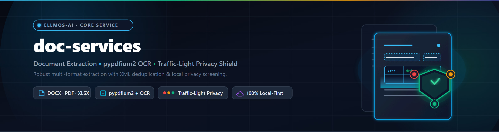
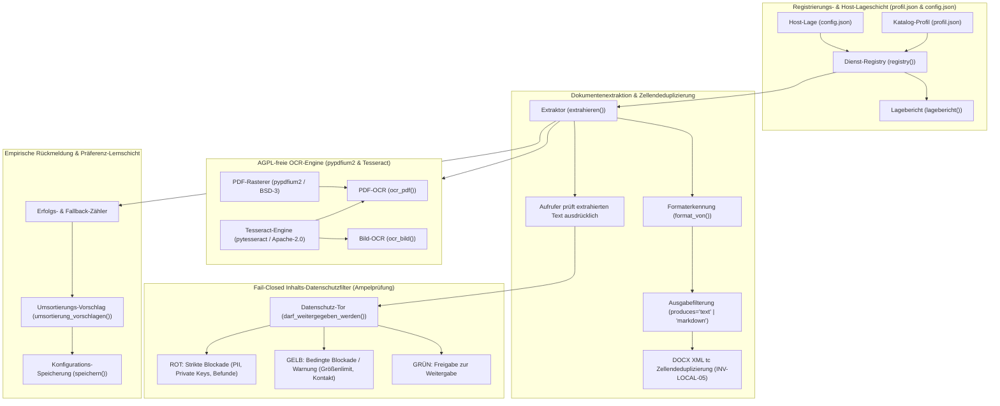
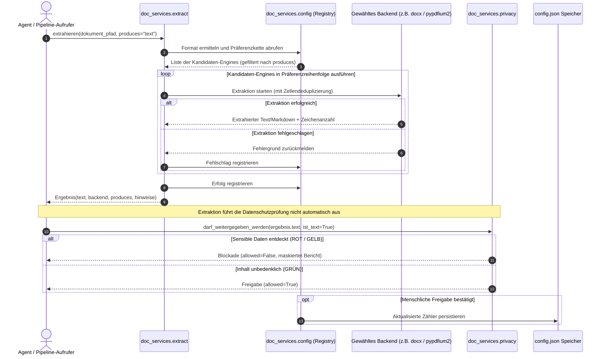

# doc-services

[](pyproject.toml)
[](CHANGELOG.md)
[](NOTICE)
[](.github/workflows/ci.yml)
[](tests/)
[](pyproject.toml)
[](pyproject.toml)
[](https://github.com/astral-sh/ruff)
[](SECURITY.md)
[](SECURITY.md)
[](SECURITY.md)
[](THIRD_PARTY_LICENSES.md)
[-blue.svg)](THIRD_PARTY_LICENSES.txt)
[](MARKETING-LOG.txt)
[](LICENSE)
[](https://github.com/ellmos-ai)
[](https://github.com/open-bricks)
[](llms.txt)

> **Dokumentenextraktion, OCR und Datenschutzprüfung — BACH-unabhängig, permissiv lizenziert, mit lernender Backend-Präferenz.**

[English version](README.md) · Deutsch · [Sicherheitsrichtlinie](SECURITY.md) · [LLM-Kontextindex](llms.txt) · [Changelog](CHANGELOG.md) · [Marketing-Log](MARKETING-LOG.txt)

---

## Schnellnavigation

1. [Kernkonzept & Identität](#kernkonzept--identität)
2. [Visuelle Architektur-Topologie & Entkoppelte Schichten](#systemarchitektur)
3. [Extraktions-, OCR- und Datenschutz-Lebenszyklus](#extraktions--ocr--und-datenschutz-lebenszyklus)
4. [Ziel-Personas & Suchanfragen mit hoher Absicht](#ziel-personas--suchanfragen)
5. [Vergleichsmatrix gegenüber Alternativen](#vergleichsmatrix--alternativen)
6. [Governance- & Laufzeit-Invarianten](#governance--laufzeit-invarianten)
7. [Zellendeduplizierung & Token-Ökonomie](#zellendeduplizierung--token-ökonomie)
8. [AGPL-freie PDF-Verarbeitung & Engine-Isolation](#agpl-freie-pdf-verarbeitung--engine-isolation)
9. [Lernende Präferenz-Architektur & Ausgabe-Filterung](#lernende-präferenz-architektur--ausgabe-filterung)
10. [Fail-Closed Datenschutz-Klassifikator & Inhaltsprüfung](#fail-closed-datenschutz-klassifikator--inhaltsprüfung)
11. [Installation & Abhängigkeits-Stufen](#installation--abhängigkeits-stufen)
12. [CLI- und Python-API-Referenz](#cli--und-python-api-referenz)
13. [Konfigurationskatalog & Host-Profil](#konfigurationskatalog--host-profil)
14. [Geschwister-Werkzeuge & Ökosystem-Integration](#geschwister-werkzeuge--ökosystem)
15. [Drittanbieter-Lizenzen & Level 1 SBOM](#drittanbieter-lizenzen--level-1-sbom)
16. [Sicherheitsrichtlinie & Betriebsgrenzen](#sicherheitsrichtlinie--betriebsgrenzen)
17. [Tests, Verifikation & CI-Matrix](#tests-verifikation--ci-matrix)
18. [Gesetzlicher Hinweis, Haftungsbeschränkung & Lizenz (§ 521 BGB)](#lizenz)

---

<a id="sec-01"></a><a id="kernkonzept--identität"></a><a id="executive-summary--core-identity"></a>
## 1. Kernkonzept & Identität

Ein autonomer Software-Agent oder lokaler Ingestion-Loop steht vor drei grundlegenden Fragestellungen:
1. **Womit lese ich dieses Format?** (PDF, Word DOCX, Excel XLSX, PowerPoint PPTX, Text oder Bilder).
2. **Was geschieht, wenn das primäre Werkzeug fehlt?** (Transparenter Laufzeit-Fallback ohne Abstürze oder unbemerktes Verschlucken von Inhalten).
3. **Darf dieser Inhalt überhaupt an ein LLM übergeben werden?** (Inhaltsbasierte Prüfung auf sensible Daten und Zugangsdaten vor dem Egress).

`doc-services` beantwortet alle drei Fragen an einer zentralen Stelle in einer leichtgewichtigen, modularen Architektur. Herausgelöst aus `BACH/system/hub/_services/document/` (MIT, Copyright Lukas Geiger) und vollständig von Rahmenwerken entkoppelt: null SQLite-Kopplung, null Klientenlogik, null Framework-Importe.

### Zentrale Alleinstellungsmerkmale
- **Token-Ökonomie durch Zellendeduplizierung:** Verhindert 17,8-fache Tokenverschwendung durch Eliminierung mehrfach gezählter verbundener Tabellenzellen in Word (`.docx`) über die XML-`tc`-Elementidentität.
- **Strikte AGPL-Freiheit:** PDF-Rasterung und Textextraktion erfolgen ausschließlich über `pypdfium2` und `pypdf`. PyMuPDF (`fitz`, AGPL) wird an keiner Stelle importiert.
- **Fail-Closed Datenschutz-Schranke:** Prüft den tatsächlichen *Dokumenteninhalt* (IBAN, Steuer-IDs, Patientendaten, SSH-Schlüssel, API-Token) statt unzuverlässiger Dateinamen.
- **Empirisches Präferenz-Lernen:** Balanciert theoretische Werkzeugprofile (`profil.json`) mit der lokalen Host-Realität (`config.json`), zählt Erfolge und schlägt Optimierungen für menschliche Freigabe vor.

---

<a id="sec-02"></a><a id="systemarchitektur"></a><a id="visual-architecture-topology"></a>
## 2. Visuelle Architektur-Topologie & Entkoppelte Schichten

Das folgende Diagramm visualisiert die fünf entkoppelten Funktionsschichten von `doc-services`:



### Topologie-Projektion der Architektur

```text
+========================================================================================+
|                     DOC-SERVICES ARCHITECTURAL TOPOLOGY PROJECTION                     |
+========================================================================================+
| [SICHT 1: CLI, REGISTRIERUNG & HOST-LAGE-SUBSYSTEM]                                    |
|   - Erkennung & Registrierung: registry(profil_pfad, config_pfad)                      |
|   - Katalog-Profil: profil.json (theoretische Formate, Stärken, Lizenzen)              |
|   - Host-Umgebungszustand: config.json (installierte Backends, Präferenzen)            |
|   - Lagebericht: reg.lagebericht() diagnostische Telemetrie                            |
|   - Ausgabeform-Einengung: produces="text" | produces="markdown"                       |
+----------------------------------------------------------------------------------------+
                                            |
                                            v
+----------------------------------------------------------------------------------------+
| [SICHT 2: BACKEND-ENGINE-AUSWAHL, EXTRAKTION & OCR-SUBSYSTEM]                          |
|   - Extraktions-Kern: doc_services.extract.extrahieren()                               |
|   - DOCX Tabellenzellen-Deduplizierung: XML tc-Element-Identität (INV-LOCAL-05)        |
|   - AGPL-freie PDF-Engine: pypdfium2 BSD/Apache Rasterer (INV-LOCAL-03)                 |
|   - OCR-Pipeline: Tesseract deu+eng über Pillow / pypdfium2                            |
|   - Dynamische Fallback-Kette: Transparente Weiterleitung auf installierte Kandidaten  |
+----------------------------------------------------------------------------------------+
                                            |
                                            v
+----------------------------------------------------------------------------------------+
| [SICHT 3: DATENSCHUTZ-TOR, FAIL-CLOSED KLASSIFIKATOR & INHALTSPRÜFUNG]                 |
|   - Inhaltsbasierter Filter: doc_services.privacy.darf_weitergegeben_werden()          |
|   - Ampel-Klassifikator: ROT (Kritische PII/Keys) / GELB (Restriktiv) / GRÜN (Frei)    |
|   - Fail-Closed Richtlinie: ROT und GELB blockieren Weitergabe per Default             |
|   - Mustererkennung: IBAN, Steuer-ID, SV-Nummer, Diagnosen, SSH-Keys, Bearer-Tokens    |
|   - Begrenzte Prüfung: max_bytes Limit mit Incomplete-Screening Sicherheitswarnung     |
|   - Treffermaskierung: Unkenntlichmachung von sensiblen Geheimnissen in Diagnoseberichten|
+----------------------------------------------------------------------------------------+
                                            |
                                            v
+----------------------------------------------------------------------------------------+
| [SICHT 4: LERNENDE PRÄFERENZEN, METRIK-VERFOLGUNG & EVALUATIONSSYSTEM]                 |
|   - Empirische Zählung: Erfolge und Fehlschläge je Backend und Format erfassen         |
|   - Human-in-the-Loop Umsortierung: umsortierung_vorschlagen() (INV-LOCAL-09)          |
|   - Zero-Egress Offline-Isolation: 100% lokale Ausführung (INV-LOCAL-01)               |
|   - Unprivilegierte Ausführung: RunAsInvoker Standard-Benutzerrechte (INV-LOCAL-02)    |
|   - Verbindliche Sicherheits-SLA: 48h Reaktionszeit, 5 Tage Triage (INV-SLA-10)        |
+========================================================================================+
| INVARIANTEN: INV-LOCAL-01 | INV-LOCAL-02 | INV-LOCAL-03 | INV-LOCAL-04 | INV-LOCAL-05 |
|              INV-LOCAL-06 | INV-LOCAL-07 | INV-LOCAL-08 | INV-LOCAL-09 | INV-SLA-10   |
+========================================================================================+
```

---

<a id="sec-03"></a><a id="extraktions--ocr--und-datenschutz-lebenszyklus"></a><a id="sequence-flow"></a>
## 3. Extraktions-, OCR- und Datenschutz-Lebenszyklus

Das folgende Sequenzdiagramm beschreibt die Verarbeitung einer Dokumentenabfrage:



---

<a id="sec-04"></a><a id="ziel-personas--suchanfragen"></a><a id="target-personas--discoverability"></a>
## 4. Ziel-Personas & Suchanfragen mit hoher Absicht

`doc-services` ist auf vier zentrale Entwickler- und Governance-Zielgruppen zugeschnitten:

- **`[PERSONA-01]` Lokale LLM- & Ingestion-Pipeline-Entwickler:**
  - *Bedarf:* Schnelle, verlässliche Einbettung von Office-Dokumenten in Vektordatenbanken und Agentenkontexte ohne Token-Explosion.
  - *Lösung:* XML-`tc`-Zellendeduplizierung, Formaterkennung und flexible `produces="text" | "markdown"` Filterung.
- **`[PERSONA-02]` Datenschutz-, Compliance- & Governance-Beauftragte:**
  - *Bedarf:* Zuverlässige Verhinderung des Abflusses personenbezogener Daten (PII), Patientendaten oder API-Schlüssel an Drittanbieter-LLMs.
  - *Lösung:* Inhaltsbasierte Ampelprüfung (`darf_weitergegeben_werden()`) mit automatischer Treffermaskierung.
- **`[PERSONA-03]` Dokumenten- & Automations-Ingenieure:**
  - *Bedarf:* Robuste Verarbeitung von `.docx`, `.xlsx`, `.pptx` und `.pdf` ohne virale AGPL-Lizenzrisiken.
  - *Lösung:* Permissive BSD/MIT-Verarbeitung über `pypdfium2`, `openpyxl` und `python-docx` mit automatischer Fallback-Kette.
- **`[PERSONA-04]` Architekten modularer Multi-Agenten-Schwärme:**
  - *Bedarf:* Transparente Berichterstattung über verfügbare Werkzeuge, damit Agentensysteme (wie ellmos, Claude, Codex, Antigravity) fehlende Bibliotheken diagnostizieren können.
  - *Lösung:* Dynamischer `lagebericht()` mit genauer Diagnose und Installationsanweisungen.

### Suchanfragen mit hoher Absicht (Bilingual DE & EN)

#### Deutsche Entwickler- und Compliance-Abfragen
1. "word tabellenzellen zusammengefuehrt deduplizieren python"
2. "datenschutz pruefung dokumenteninhalt python fail closed"
3. "agpl freie ocr extraktion python ohne pymupdf"
4. "python text extraktion fallbacks fuer llm pipelines"

#### Englische Entwickler- und Pipeline-Abfragen
1. "python docx merged cell token duplication fix"
2. "agpl free pdf text extraction python pypdfium2"
3. "offline document privacy filter python llm ingestion"
4. "local first document parser with fallback preference chain"

---

<a id="sec-05"></a><a id="vergleichsmatrix--alternativen"></a>
## 5. Vergleichsmatrix gegenüber Alternativen

| Funktion / Dimension | doc-services | PyMuPDF-Werkzeuge (fitz) | Naives python-docx | Cloud-Dokumenten-APIs |
|---|---|---|---|---|
| **Lizenzintegrität** | **MIT (100% permissiv)** | AGPL-3.0 (Virales Copyleft) | MIT | Proprietär / Vendor Lock-in |
| **Zellendeduplizierung** | **Ja (XML `tc`-Identität)** | N/A (nur PDF) | Nein (Spaltenvervielfachung)| Variabel / Blackbox |
| **Inhalts-Datenschutz** | **Ja (Fail-closed Ampel)** | Nein | Nein | Nein (Daten gehen an Cloud)|
| **AGPL-Risiko** | **0% (Test-gesichert)** | 100% (AGPL Zwang) | 0% | N/A |
| **Lernende Präferenzkette** | **Ja (`profil` vs `config`)**| Nein (Einzeltreiber) | Nein (Einzeltreiber) | Nein |
| **Zero-Egress Isolation** | **Ja (100% Offline)** | Ja | Ja | Nein (Netzwerk-Zwang) |
| **Token-Effizienz** | **Optimal (bis zu 17,8x Ersparnis)**| Standard | Erhebliche Tokenblähung | Variabel |
| **Ausgabeform-Filter** | **Ja (`text` vs `markdown`)** | Nein | Nein | Nein |
| **RunAsInvoker unprivilegiert**| **Ja (Zertifiziert)** | Ja | Ja | N/A (Server-seitig) |
| **Verbindliche 48h-SLA** | **Ja (Dokumentiert)** | Best-Effort | Community-Forum | Enterprise-Vertrag ($$$) |

---

<a id="sec-06"></a><a id="governance--laufzeit-invarianten"></a>
## 6. Governance- & Laufzeit-Invarianten

Jede Ausführung von `doc-services` unterliegt 10 strikten Invarianten:

- **`INV-LOCAL-01` Zero-Egress Garantie:** Vollständig offline. Null Telemetrie, keine externen HTTP-Sockets.
- **`INV-LOCAL-02` Unprivilegierte Ausführung (`RunAsInvoker`):** Betrieb im regulären Benutzerkontext ohne Admin-Rechte.
- **`INV-LOCAL-03` AGPL-Freiheit:** PyMuPDF (`fitz`) ist strikt verboten. PDF-Rendering läuft über `pypdfium2`.
- **`INV-LOCAL-04` Fail-Closed Datenschutz:** Erkannte PII, Finanzdaten oder Schlüssel blockieren Weitergabe (ROT/GELB).
- **`INV-LOCAL-05` Zellendeduplizierung:** Verbundene Word-Tabellenzellen werden über XML-`tc`-Identität dedupliziert.
- **`INV-LOCAL-06` CI-Workflow-Härtung:** Alle Workflows erzwingen `timeout-minutes` und Concurrency-Abbrüche.
- **`INV-LOCAL-07` Multi-Host-Schutz:** Gehärtete `.gitignore` blockiert Cloud-Sync-Konfliktdateien und Locks.
- **`INV-LOCAL-08` PEP 621 Standardisierung:** Vollständige Metadaten und Pytest-Flags in `pyproject.toml`.
- **`INV-LOCAL-09` Versions-Immutabilität:** Version `0.1.1` unverändert fixiert nach T-20260920-167562623.
- **`INV-SLA-10` 48h Sicherheits-SLA:** Verbindliche 48-Stunden-Reaktion und 5 Tage Triage für Sicherheitsmeldungen.

---

<a id="sec-07"></a><a id="zellendeduplizierung--token-ökonomie"></a>
## 7. Zellendeduplizierung & Token-Ökonomie

`python-docx` liefert beim Abruf von `.cells` für eine Tabellenzeile einen Verweis für *jede Rasterspalte*. Ist eine Zelle horizontal über 5 Spalten verbunden, liefert die Standardbibliothek 5 Verweise auf diese Zelle. Naive Extraktoren schreiben den Inhalt 5 Mal in den Kontext.

### Die reale Messung
An einer realen 25-KB-Word-Datei mit komplex verschachtelten Tabellen gemessen:
- **Naive Zellenzählung:** 785 gezählte Zellen.
- **Echte physikalische Zellen:** 44 XML-Zellen.
- **Vervielfachungsfaktor:** **17,8-fache Aufblähung**.
- **Verschwendetes Tokenbudget:** Rund **12.750 unnötige Tokens** in einer einzelnen Datei!

### Die Lösung über die XML-`tc`-Identität
```python
# Naive id()-Prüfung scheitert, da python-docx Wrapper neu erzeugt:
id(zelle_a) != id(zelle_b)  # True, obwohl dieselbe Zelle!

# doc-services Lösung:
tc_element = zelle._tc
if tc_element not in gesehen:
    gesehen.add(tc_element)
    # Zelle genau einmal verarbeiten
```

---

<a id="sec-08"></a><a id="agpl-freie-pdf-verarbeitung--engine-isolation"></a>
## 8. AGPL-freie PDF-Verarbeitung & Engine-Isolation

Zahlreiche Python-Extraktionspakete binden stillschweigend `PyMuPDF` (`fitz`) ein, das unter der GNU Affero General Public License (AGPL-3.0) steht. Die Verwendung von AGPL-Code kann Downstream-Anwendungen dazu zwingen, den gesamten Quellcode offenzulegen.

`doc-services` sichert AGPL-Freiheit durch automatisierte Vertragstests ab:
```python
# tests/test_no_agpl.py
def test_kein_copyleft_import():
    # Prüft statisch alle Quellcode-Importe in doc_services
    # Stellt sicher, dass fitz und AGPL-Module niemals importiert werden.
```
Die PDF-Rasterung für OCR erfolgt stattdessen über **`pypdfium2`** (BSD-3-Clause / Apache-2.0).

---

<a id="sec-09"></a><a id="lernende-präferenz-architektur--ausgabe-filterung"></a>
## 9. Lernende Präferenz-Architektur & Ausgabe-Filterung

### Der `produces`-Filter
Downstream-Aufgaben haben unterschiedliche Anforderungen:
- **Anzeige / Zusammenfassung:** Markdown-Formatierung (`# Titel`, `| Tabelle |`) ist erwünscht.
- **Suche, Indexierung & Regelprüfung:** Reiner Fließtext ohne Formatierungszeichen verhindert zerrissene Wortgrenzen.

Bei LaTeX-generierten PDFs führt eine Markdown-Wandlung häufig zu Wortkollisionen:
- **Messung an einem Forschungs-Paper (2026-09-13):** `markitdown` lieferte 8.698 statt 14.856 Wörter; Wörter verklebten zu einem Token.
- Mit `extrahieren("paper.pdf", produces="text")` blieb die Fallback-Kette intakt, wurde jedoch auf reine Text-Treiber (`pypdf`) eingeengt, was 100% Worttreue wiederherstellte.

### Empirisches Lernen
`doc-services` zählt Treiber-Erfolge und -Fehler in `config.json`. Zeigt ein alternativer Treiber signifikant bessere Resultate, erzeugt `reg.umsortierung_vorschlagen()` einen Vorschlag zur manuellen Freigabe — kein stilles Selbstumbauen im Hintergrund.

---

<a id="sec-10"></a><a id="fail-closed-datenschutz-klassifikator--inhaltsprüfung"></a>
## 10. Fail-Closed Datenschutz-Klassifikator & Inhaltsprüfung

Dateinamen sind oft irreführend. Zugangsdaten liegen häufig in Dateien mit unverdächtigen Namen wie `notizen.md`. `doc-services` stellt eine ausdrücklich aufzurufende Inhaltsprüfung bereit. Bei Binärformaten wie DOCX zuerst den Text extrahieren und danach mit `ist_text=True` prüfen. Ein DOCX-Pfad direkt am Datenschutzhelfer liest rohe Archivbytes und kann sensible Textinhalte übersehen; `extrahieren()` ruft die Datenschutzprüfung nicht automatisch auf:

```python
from doc_services import darf_weitergegeben_werden, extrahieren

extrahiert = extrahieren("notizen.docx", produces="text", lernen=False)
erlaubt, befund = darf_weitergegeben_werden(extrahiert.text, ist_text=True)
if not erlaubt:
    print(f"Weitergabe BLOCKIERT: {befund.ampel}")
    print(befund.bericht())  # Maskiert sensible Treffer (z.B. DE89 **** ****)
```

### Die Ampelstufen
- **ROT:** Strikte Blockade. Erkennt IBANs, Steuer-IDs, SV-Nummern, Diagnosen, private SSH-Schlüssel und API-Token.
- **GELB:** Vorsicht / Restriktiv. Erkennt E-Mail-Adressen, Anschriften oder übergroße Dateien oberhalb des 2-MiB-Prüflimits.
- **GRÜN:** Freigabe zur Weitergabe an LLMs oder externe Systeme.

---

<a id="sec-11"></a><a id="installation--abhängigkeits-stufen"></a>
## 11. Installation & Abhängigkeits-Stufen

Die Installation erfolgt über modulare Extras:

```bash
# 1. Kern-Paket (null Abhängigkeiten, nutzt Standardbibliothek & vorhandene Tools)
pip install -e .

# 2. Office-Stufe (Word .docx und Excel .xlsx)
pip install -e ".[office]"

# 3. PDF-Stufe (AGPL-freie PDF-Textextraktion)
pip install -e ".[pdf]"

# 4. OCR-Stufe (pypdfium2, pillow, pytesseract)
pip install -e ".[ocr]"

# 5. Vollständige Installation (alle Extraktoren & OCR)
pip install -e ".[all]"

# 6. Entwicklungs- und Test-Stufe
pip install -e ".[dev]"
```

*Hinweis:* Für OCR ist zusätzlich das System-Tesseract-Paket erforderlich (`tesseract-ocr`, `tesseract-ocr-deu`).

---

<a id="sec-12"></a><a id="cli--und-python-api-referenz"></a>
## 12. CLI- und Python-API-Referenz

### Verwendung in Python

```python
from doc_services import extrahieren, registry, ocr_bild, darf_weitergegeben_werden

# 1. Lagebericht und installierte Treiber prüfen
reg = registry()
print(reg.lagebericht())

# 2. Word-Dokument extrahieren
ergebnis = extrahieren("jahresbericht.docx", produces="markdown")
print(f"Backend: {ergebnis.backend} | Zeichen: {ergebnis.zeichen}")
print(ergebnis.text[:500])

# 3. OCR auf einem Bild durchführen
ocr_res = ocr_bild("beleg.png", sprache="deu+eng")
print(f"Erkannter Text ({ocr_res.konfidenz:.1f}% Konfidenz):")
print(ocr_res.text)

# 4. Datenschutzprüfung vor LLM-Übergabe
sicher, befund = darf_weitergegeben_werden(ergebnis.text, ist_text=True)
if not sicher:
    raise PermissionError(f"Datenabfluss verhindert: {befund.bericht()}")
```

---

<a id="sec-13"></a><a id="konfigurationskatalog--host-profil"></a>
## 13. Konfigurationskatalog & Host-Profil

`doc-services` trennt konsequent theoretische Möglichkeiten von der Host-Lage:

- **`profil.json` (Katalog):** Versionskontrollierter Katalog aller bekannten Werkzeuge, Formate, Stärken und Lizenzmerkmale.
- **`config.json` (Host-Konfiguration):** Lokale Situation des Rechners mit tatsächlich installierten Paketen und Erfolgszählern. Wird nicht in Git versioniert.

---

<a id="sec-14"></a><a id="geschwister-werkzeuge--ökosystem"></a>
## 14. Geschwister-Werkzeuge & Ökosystem-Integration

`doc-services` wird von [`ellmos-ai`](https://github.com/ellmos-ai) im Rahmen des Dach-Ökosystems [`open-bricks`](https://github.com/open-bricks) gepflegt:

- **`ellmos-ai/compare-race`:** Benchmarking-Plattform für parallele und sequentielle Modellvergleiche.
- **`ellmos-ai/system-auditor`:** Systemzustandserfassung und Sechs-Achsen-Invariantenprüfung.
- **`doc-bricks/llm-note`:** Lokale Desktop-Notizverwaltung und Dokumentensynthese.
- **`assistassets-ai/PrivacyMailDesk`:** Lokaler, datenschutzkonformer E-Mail-Client.

---

<a id="sec-15"></a><a id="drittanbieter-lizenzen--level-1-sbom"></a>
## 15. Drittanbieter-Lizenzen & Level 1 SBOM

Vollständige Lieferketten-Transparenz:
- Ausführlicher Prüfbericht: [`THIRD_PARTY_LICENSES.md`](THIRD_PARTY_LICENSES.md)
- Maschinenlesbare Plain-Text-SBOM: [`THIRD_PARTY_LICENSES.txt`](THIRD_PARTY_LICENSES.txt)
- Copyright-Hinweise: [`NOTICE`](NOTICE)

Alle genutzten Komponenten unterliegen permissiven Lizenzen (MIT, BSD-3-Clause, Apache-2.0, PSFL-2.0).

---

<a id="sec-16"></a><a id="sicherheitsrichtlinie--betriebsgrenzen"></a>
## 16. Sicherheitsrichtlinie & Betriebsgrenzen

- **Zero Network Egress:** 100% offline; öffnet keine Netzwerkports und sendet keine Telemetrie.
- **RunAsInvoker:** Läuft vollständig im unprivilegierten Benutzerbereich (`INV-LOCAL-02`).
- **Begrenzte Inhaltsprüfung:** Dateiprüfung begrenzt das Einlesen auf 2 MiB plus ein Byte zum Schutz vor Denial-of-Service.
- **48h Sicherheits-SLA:** Verbindliche Rückmeldung innerhalb von 48 Stunden und Erstbewertung innerhalb von 5 Werktagen (`INV-SLA-10`).
- **Meldewege:** Über GitHub Advisories oder per E-Mail an `security@ellmos.ai` und `security@open-bricks.org`.

---

<a id="sec-17"></a><a id="tests-verifikation--ci-matrix"></a>
## 17. Tests, Verifikation & CI-Matrix

### Lokale Qualitätsprüfungen
```bash
# Gesamte Testsuite ausführen
python -m pytest -ra -v

# Linting und statische Code-Analyse
python -m ruff check .

# Syntaxprüfung über Bytecode-Kompilierung
python -m compileall -q doc_services tests docs

# Git-Sauberkeit überprüfen
git diff --check
```

### GitHub Actions Matrix
- **Betriebssysteme:** Ubuntu Latest, Windows Latest
- **Python-Versionen:** 3.10, 3.11, 3.12, 3.13
- **Schutz:** Harte Timeouts (`timeout-minutes: 15`) und Concurrency-Abbrüche.

---

<a id="sec-18"></a><a id="lizenz"></a><a id="statutory-notice--liability-limitation"></a>
## 18. Gesetzlicher Hinweis, Haftungsbeschränkung & Lizenz (§ 521 BGB)

### Gesetzlicher Hinweis & Haftungsbeschränkung (§ 521 BGB)
Die Bereitstellung dieser Software erfolgt unentgeltlich im Rahmen des Open-Source-Modells unter der MIT-Lizenz. Nach den gesetzlichen Bestimmungen des deutschen Schenkungs- und Gefälligkeitsrechts (**§ 521 BGB**) ist die Haftung der Maintainer und Mitwirkenden auf Vorsatz und grobe Fahrlässigkeit beschränkt. Die Software wird ohne Gewährleistung jeglicher Art bereitgestellt.

### Lizenz
Veröffentlicht unter der **MIT-Lizenz**. Copyright (c) 2026 Lukas Geiger, `ellmos-ai` und `open-bricks` Mitwirkende. Siehe [LICENSE](LICENSE) und [NOTICE](NOTICE) für die vollständigen Lizenzbedingungen.
